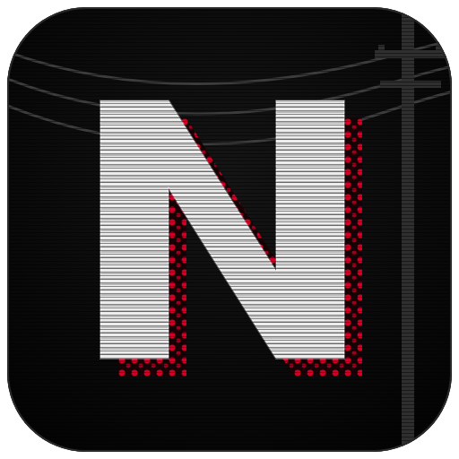
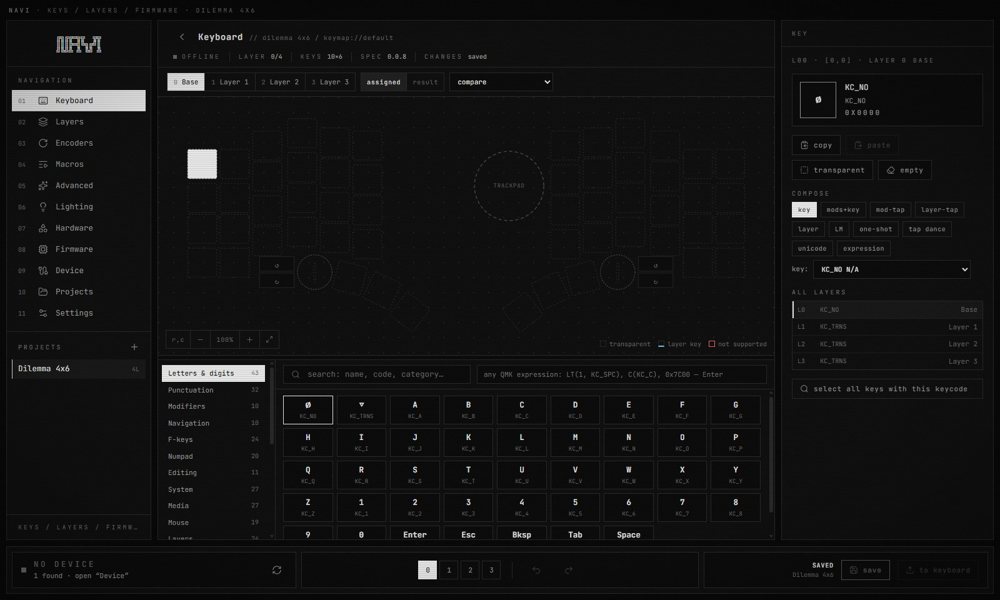
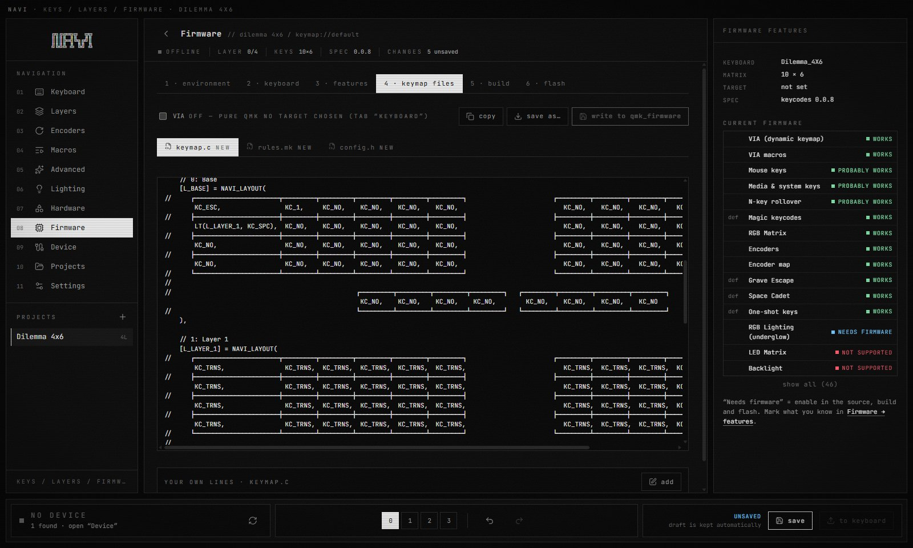

# NAVI

**Configure and flash a QMK keyboard.** Keymap and layers on a drawing of your keyboard, encoders, macros,
tap dance, combos, key overrides, leader key, unicode — then build pure QMK firmware and flash it.
Keyboards that already run VIA can be read and changed right away.

[How it is built](docs/ARCHITECTURE.md) · [Contributing](CONTRIBUTING.md)



## Features

- **Keymap on a drawing of your keyboard** — split halves, rotated thumb keys, encoders, trackpad. A catalog of all QMK
  keycodes (for the QMK version you choose) and a composer for `LT`, `MT`, `OSM`, `LM`, tap dance, unicode, any expression.
- **Layers** — add, copy, reorder, delete, compare. References to layers (`MO`/`LT`/`TG`…, tap dance, combos) are
  renumbered automatically. Several keymaps in one project (“daily”, “gaming”).
- **Encoders** per layer with presets (volume, mouse wheel, …). **Macros**: text, keys, pauses, recording.
- **Advanced** — tap dance, combos (any number of keys, own timing, only on chosen layers), key overrides,
  custom keycodes, leader key sequences, unicode map and emoji, any `config.h` option from the QMK table.
- **Keyboards with VIA** — reads everything the keyboard reports (matrix, layers, keymap, encoders, macros, lighting).
  Writing shows a plan first and reads the keyboard back afterwards to verify. Live lighting control.
- **Your own firmware** — generates `keymap.c`, `rules.mk`, `config.h`, builds with the QMK CLI, keeps a firmware archive,
  flashes (UF2 with a chip family check, or `qmk flash`) and saves the current firmware from an RP2040 bootloader drive first.
- **Hardware editor** — move keys, assign matrix positions, describe board pins and generate your own QMK target.
- **Projects** — drafts that survive closing, undo/redo, 50 saved versions with a diff, trash.
  Import/export: QMK `keymap.json` / `info.json`, VIA definition and backup, KLE.
- English and Russian interface, palettes, CRT effects.

## Readable keymap.c

Layers are written the way the keys sit on the keyboard. A `NAVI_LAYOUT` macro maps them to the matrix,
so the file does not depend on the `LAYOUT` macro of a particular keyboard and is easy to edit by hand.
Matrix positions that are used but have no key on the drawing go to a separate last line, so nothing is lost
(an excerpt for the Dilemma 4x6 template; wide lines scroll):

```c
    [L_BASE] = NAVI_LAYOUT(
//     ┌────────────────┬─────────┬─────────┬─────────┬─────────┬─────────┐                           ┌─────────┬─────────┬─────────┬─────────┬─────────┬─────────┐
        KC_ESC,          KC_1,     KC_2,     KC_3,     KC_4,     KC_5,                                 KC_6,     KC_7,     KC_8,     KC_9,     KC_0,     KC_BSPC,
//     ├────────────────┼─────────┼─────────┼─────────┼─────────┼─────────┤                           ├─────────┼─────────┼─────────┼─────────┼─────────┼─────────┤
        KC_TAB,          KC_Q,     KC_W,     KC_E,     KC_R,     KC_T,                                 KC_Y,     KC_U,     KC_I,     KC_O,     KC_P,     KC_BSLS,
//     ├────────────────┼─────────┼─────────┼─────────┼─────────┼─────────┤                           ├─────────┼─────────┼─────────┼─────────┼─────────┼─────────┤
        LCTL_T(KC_ESC),  KC_A,     KC_S,     KC_D,     KC_F,     KC_G,                                 KC_H,     KC_J,     KC_K,     KC_L,     KC_SCLN,  KC_QUOT,
//     ├────────────────┼─────────┼─────────┼─────────┼─────────┼─────────┤                           ├─────────┼─────────┼─────────┼─────────┼─────────┼─────────┤
        KC_LSFT,         KC_Z,     KC_X,     KC_C,     KC_V,     KC_B,                                 KC_N,     KC_M,     KC_COMM,  KC_DOT,   KC_SLSH,  KC_RSFT,
//     └────────────────┴─────────┴─────────┴─────────┴─────────┴─────────┘                           └─────────┴─────────┴─────────┴─────────┴─────────┴─────────┘
//
//                                          ┌─────────┬─────────┬─────────────┬─────────┐   ┌─────────┬─────────┬─────────────────────┬─────────┐
                                             KC_MUTE,  KC_LGUI,  MO(L_LOWER),  KC_SPC,       KC_RALT,  KC_BSPC,  LT(L_LOWER, KC_ENT),  KC_MPLY,
//                                          └─────────┴─────────┴─────────────┴─────────┘   └─────────┴─────────┴─────────────────────┴─────────┘
//      matrix positions that are not on the diagram: [4,3]
        KC_LALT
    ),
```



## Requirements

- **Windows 10/11.** NAVI is developed and tested on Windows; other systems are untested.
- **Node.js 22.12** or newer.
- To build firmware: [QMK MSYS](https://msys.qmk.fm) (or the `qmk` CLI) and a `qmk_firmware` checkout.
  Editing keymaps and working with VIA keyboards does not need QMK.

## Getting started

```
git clone <this repository>
cd <folder>
npm install
npm run app
```

On the first start choose how to create a project: from the connected keyboard (read-only), from a template,
as a blank grid, or by importing a file.

| Command | What it does |
|---|---|
| `npm run app` | build and open the app |
| `npm run app:dev` | development mode with hot reload |
| `npm test` | tests (core logic and the main process) |
| `npm run typecheck` | TypeScript check |
| `npm run build` | build the interface into `dist/` |
| `npm run dist` | Windows installer into `release/` |
| `npm run icon` | redraw the icons from `build/icon.svg` |
| `npm run gen:qmk -- <qmk_firmware>` | regenerate QMK data (keycodes, effects, config tables) |
| `npm run device:probe` | print what every connected VIA keyboard reports (read-only) |

Your projects are stored in `%APPDATA%\NAVI\projects`. Unsaved edits are kept as a draft.

## Safety

- NAVI never writes to a keyboard or flashes without you pressing the button, and shows the changes first.
- Building runs `make` on your computer, so a project cannot add arbitrary build commands: `rules.mk` accepts only
  feature flags and drivers, and custom code from an imported project is not written until you review it and press “allow”.
- Statuses are never faked: “written”, “built”, “flashed” are shown only after the keyboard answers, the file is read back,
  the build exits with success or the device appears.
- Keyboards with unknown firmware: save the current firmware before flashing your own (Firmware → flash).

## Keyboard notes

NAVI started for a Dilemma 4x6 clone by lucky_studio — see [docs/dilemma-4x6-clone.md](docs/dilemma-4x6-clone.md).
It works with any QMK keyboard: describe it in the Hardware section or import its `keyboard.json` / VIA definition / KLE layout.

## License

NAVI's own code is released under the [MIT license](LICENSE) — use it, change it, share it.
Files in `src/core/qmk-data` are derived from [QMK Firmware](https://github.com/qmk/qmk_firmware) (GPL-2.0-or-later);
see [THIRD_PARTY_NOTICES.md](THIRD_PARTY_NOTICES.md).

NAVI is not affiliated with QMK, VIA, Vial or Bastard Keyboards. The icon is original artwork inspired by the look of
*Serial Experiments Lain*.
